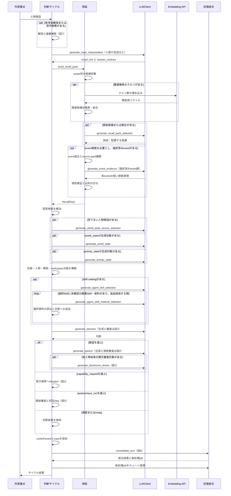
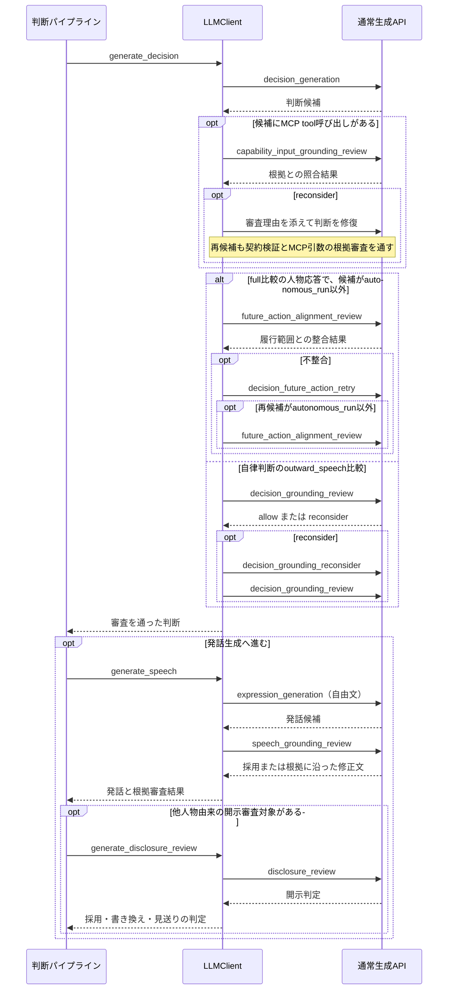
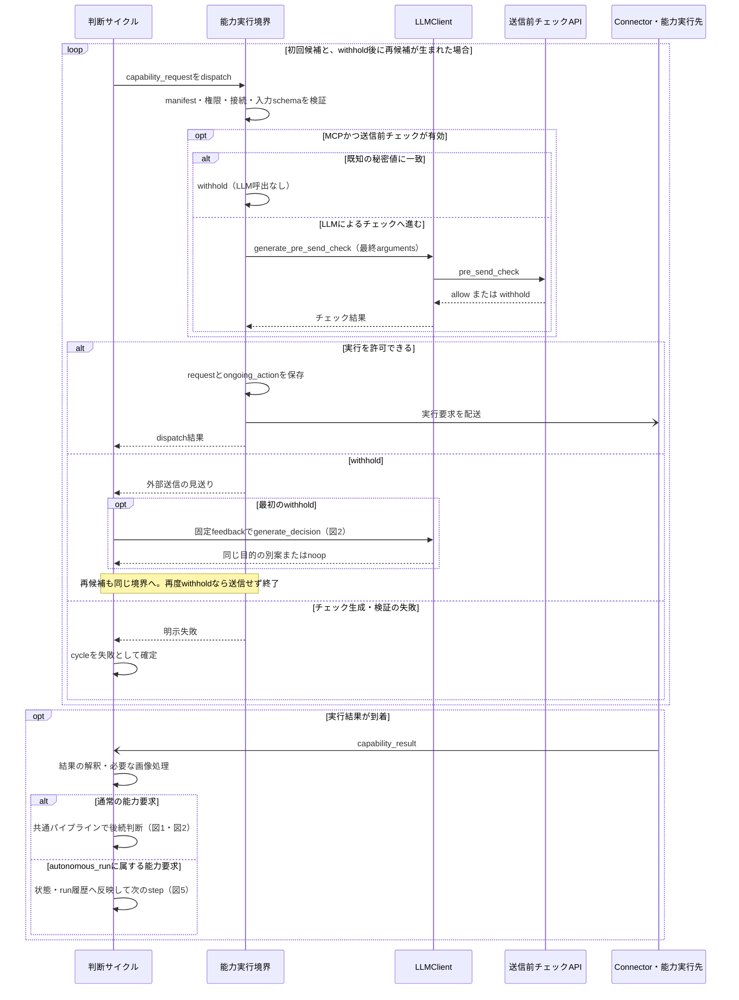
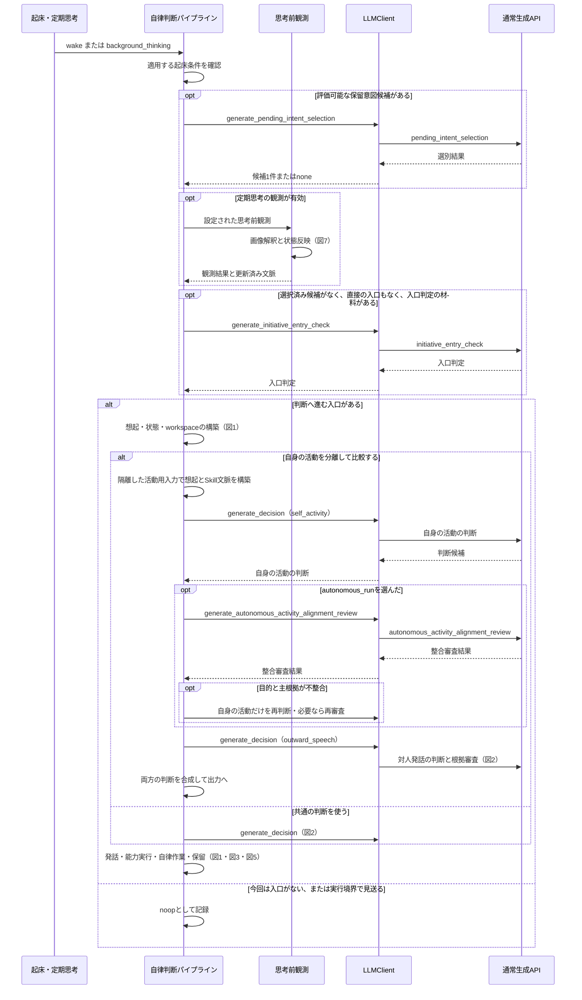
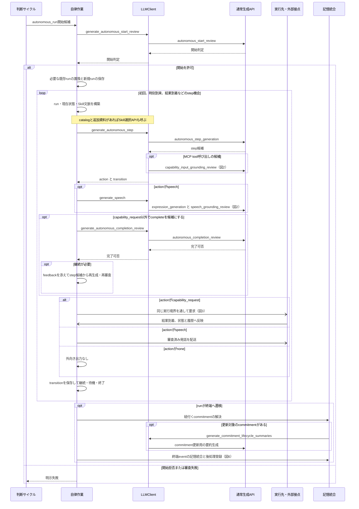
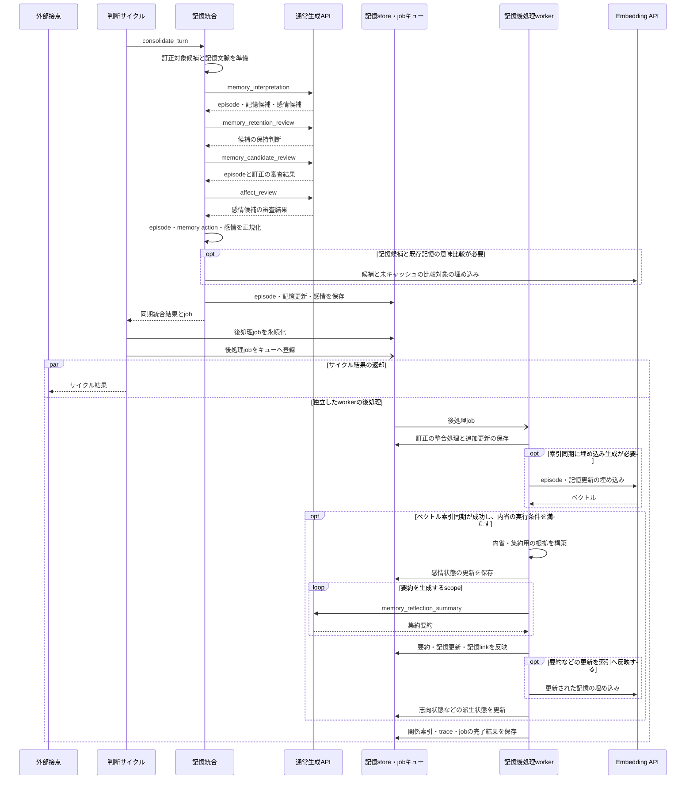
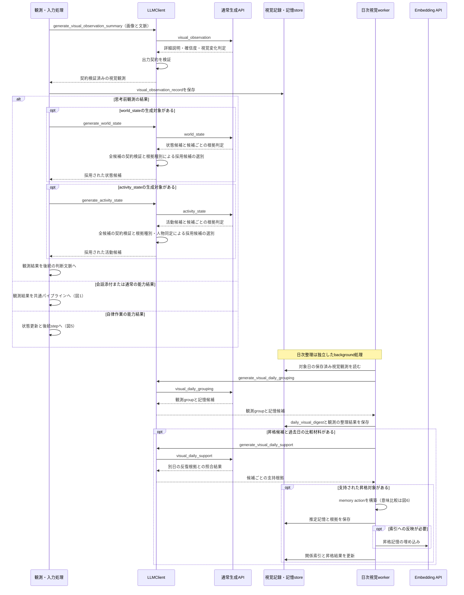

# LLM 呼び出しシーケンス

この文書は、主要な LLM 呼び出しを実装から追うための見取り図である。
内部フローはコードを正とし、意味境界、入出力契約、失敗条件の詳細は各節の設計文書を参照する。
図は実 LLM を利用する経路を示す。

## 図の読み方とモデルの境界

- `LLMClient` への矢印はアプリ内の論理処理呼び出しを示す。1 回の論理処理が、生成、審査、修復のために複数回 API を呼ぶことがある。
- `通常生成API`、`送信前チェックAPI`、`Embedding API` への矢印は、実際のモデル呼び出しを示す。応答矢印は必要な箇所だけ記載する。
- 「図 N」と付いた処理は、対応する図へ展開する。コード側の候補収集、契約検証、保存は、それぞれの担当内の処理として示す。
- `opt` は条件付き処理、`alt` は分岐、`loop` は繰り返し、`par` は独立して進む処理、開いた矢印は非同期の要求・通知を示す。

| 呼び出し先 | 設定の参照先 |
| --- | --- |
| 通常生成API | 選択中の `selected_model_preset_id` が指すモデルプリセット。解釈、判断、表現、審査、記憶、視覚で共有する |
| 送信前チェックAPI | `pre_send_check_model_preset_id` が指す専用プリセット |
| Embedding API | 選択中の記憶集合の `memory_set.embedding` |

モデル設定の正本は [モデルプリセット詳細](../configuration/モデルプリセット詳細.md)、埋め込み設定は [設定モデル](../configuration/設定モデル.md) を参照する。

構造化生成は `LLMClient._generate_structured_payload()` から `transport.complete_text()`、LiteLLM の順に進む。
解析・契約検証に失敗した場合の repair は、検証エラーを添えて同じモデルへ生成を依頼する処理である。
これとは別に、transport には provider の終了理由が `error` の応答に対する同一リクエストの再送がある。
API 呼び出し自体の例外は呼び出し元へ返り、別モデルへの切り替えは行わない。
修復、意味審査に伴う再生成、同一リクエスト再送はそれぞれ別の呼び出しであり、図の矢印の本数を固定のリクエスト数とは扱わない。
構造化出力の契約は [LLM構造化出力transport](LLM構造化出力transport.md)、使用量の記録は [デバッグ可能性](../runtime/デバッグ可能性.md#llm-生成使用量) を参照する。

## 図 1: 通常の判断サイクル

入口は人物発話を受ける `handle_conversation()`。
想起、状態と Skill の文脈構築、判断、出力、記憶統合の順に進む。
図中の `LLMClient` 呼び出しは、下位の生成と審査をまとめて示す。

`generate_input_interpretation()` は、記憶検索に先立って「何を思い出すか」「どんな根拠を探すか」を決める入口処理である。正常時は1回の LLM 呼び出しで、次の2つをまとめて返す。

| 出力 | 役割と後続処理 |
| --- | --- |
| `recall_hint` | 想起する記憶の主題、人物・話題、時間軸、参照の曖昧さなどを整理し、後続の `build_recall_pack()` に渡す |
| `answer_contract` | 原文、日時、出所など必要な根拠の種類と、検索対象の人物・会話の範囲を指定し、RecallPack 構築後の回答根拠の解決に使う |

入力には、現在の入力本文と発信者・会話などの構造化情報、人格設定、直近会話、現在時刻を渡す。解釈済みの画像説明と活動状態がある場合は、内部補助文脈として渡す。入力の詳細と出力契約は [RecallHint](../memory/想起と判断.md#recallhint) と [AnswerContract](../memory/想起と判断.md#answercontract) を正とする。

例えば「前に私が言ったことを原文で教えて」という入力では、本人の過去の会話を想起の対象とし、本人の発話原文を必要な根拠として指定する。この段階では検索方針を決め、長期記憶の検索や原文取得は後続処理が行う。行動選択と返答本文の生成は、後段の `generate_decision()` と `generate_speech()` が担当する。

`generate_world_state()` と `generate_activity_state()` は、それぞれ候補と根拠判定を同じ生成で取得し、コード側で採用候補を選ぶ。具体的な根拠判定は [状態候補の根拠判定](状態候補根拠審査.md) を参照する。
`generate_event_evidence()` は対象 event 群をまとめて呼び出し、返った各項目を想起側で検証する。

実装: [入力サイクル](../../../src/otomekairo/service/input/cycle.py)、[共通パイプライン](../../../src/otomekairo/service/input/pipeline.py)、[想起構築](../../../src/otomekairo/recall/builder.py)、[Skill文脈](../../../src/otomekairo/service/agent_skills.py)、[結果の保存](../../../src/otomekairo/service/input/trace_persist.py)。
契約: [想起と判断](../memory/想起と判断.md)、[RecallPackのLLM選別](../memory/RecallPackのLLM選別.md)、[event_evidenceのLLM圧縮](../memory/event_evidenceのLLM圧縮.md)、[状態候補根拠審査](状態候補根拠審査.md)、[AgentSkills統合](../integration/AgentSkills統合.md)。

## 図 2: 判断と発話の審査

入口は `generate_decision()` と、発話を選んだ場合の `generate_speech()`。
審査も通常生成と同じモデル設定を使う。MCP 引数の根拠審査と、外部送信直前の開示可否チェック（図 3）は別の段階である。

MCP 引数の根拠審査は判断・step 候補の検証内で実行される。審査自体の失敗と、意味の不整合による修復は実装上も区別される。
上図の各審査の再生成条件、修復の上限、失敗の扱いは対応する契約を参照する。

実装: [LLMClient](../../../src/otomekairo/llm/client.py) の `generate_decision()`、`_review_capability_input_grounding()`、`_ground_outward_decision()`、`generate_speech()` と、[パイプライン](../../../src/otomekairo/service/input/pipeline.py) の `_apply_disclosure_review()`。
契約: [判断と行動](../runtime/判断と行動.md)、[判断根拠審査](判断根拠審査.md)、[外部本文の根拠照合](外部本文の根拠照合.md)、[想起と判断の共有許可](../memory/想起と判断.md#共有許可と受け手の照合)。

## 図 3: 能力実行、送信前チェック、結果からの後続判断

入口は判断または自律 step が返した `capability_request`。
通常判断、能力結果からの後続判断、自律作業のいずれも同じ dispatch 境界を通る。
図の再判断は通常 cycle の経路を示す。

送信前チェックでは専用モデルへ最終 payload を渡す。
自律作業の `withhold` 後は `generate_decision()` の代わりに step 候補を再生成し、再度見送りまたはチェック失敗になった場合の終了単位も通常 cycle と異なる。
具体的な入力境界、再判断、終了の規則は [送信前チェック](pre_send_check.md) を参照する。

実装: [能力実行境界](../../../src/otomekairo/service/capability.py)、[通常の能力結果サイクル](../../../src/otomekairo/service/spontaneous/capability_cycle.py)、[自律作業](../../../src/otomekairo/service/autonomous_run.py)。
契約: [実行連携](../api/実行連携.md)、[判断と行動の実行結果](../runtime/判断と行動.md#実行結果の扱い)。

## 図 4: 自律判断の入口と分離判断

入口は API の `wake` または定期思考の `background_thinking`。
時刻や候補の適格性はコードが扱い、候補の意味的な選別と判断を LLM が担当する。

新しい有効な視覚観測などから直接判断へ入れる場合は `initiative_entry_check` の API 呼び出しを省く。
その視覚観測だけを入口にする経路では、入力解釈と記憶検索を通さず観測から直接判断用文脈を作る場合がある。
自身の活動を分離する場合は、活動用の想起・Skill 選択が追加される。処理順は自身の活動判断、その整合審査、対人発話判断、合成の順である。

実装: [起床サイクル](../../../src/otomekairo/service/spontaneous/wake.py)、[保留意図の選別](../../../src/otomekairo/service/spontaneous/pending_intent.py)、[起床パイプライン](../../../src/otomekairo/service/input/wake_pipeline.py)、[分離判断](../../../src/otomekairo/service/input/decision_comparison.py)。
契約: [自律initiative_loop](../runtime/自律initiative_loop.md)、[保留意図候補のLLM選別](保留意図候補のLLM選別.md)、[判断と行動](../runtime/判断と行動.md)、[プロンプト文脈分離方針](プロンプト文脈分離方針.md)。

## 図 5: 自律作業の開始、step、完了

入口は `kind=autonomous_run` の判断。
通常判断は目的を作り、以後の一手は `generate_autonomous_step()` が決める。

step の文脈では保存済みの状態と run 履歴を読み、Skill の選択を行う。通常 cycle の入力解釈・RecallPack 構築を毎 step 実行する経路とは分かれている。
能力結果は run に対応づけて受け取り、必要な視覚解釈・`world_state` 更新を経て後続 step へ進む。
step の再生成は開始時と同じ文脈構築から行うため、Skill 選択や発話生成も再度発生しうる。
発話候補の完了審査は配送前に行う。

実装: [自律作業](../../../src/otomekairo/service/autonomous_run.py) の `_start_autonomous_run_from_decision()`、`_build_autonomous_step_context()`、`_generate_reviewed_autonomous_step_candidate()`、`_execute_autonomous_capability_result_cycle_inner()`、`_finalize_autonomous_run_commitments()`。
契約: [autonomous_run](../runtime/autonomous_run.md)、[送信前チェック](pre_send_check.md)、[音声出力](../audio/音声出力.md)。

## 図 6: 記憶統合と非同期後処理

入口は cycle 成功後の `consolidate_turn()`、または自律作業の終端からの記憶統合。
通常会話では記憶解釈と審査・保存までを同期実行し、後処理をキューへ登録してからサイクル結果を返す。

`generate_memory_candidate_review()` は内部で保持審査、episode と訂正の審査を順に呼ぶ。
後処理 worker は同期統合とは別の実行主体であり、外部への応答配送と後処理の完了順は固定されない。
内省では scope ごとの意味要約を LLM に依頼し、根拠の収集、状態の計算、正本の保存はコード側で行う。
記憶候補の意味比較に使う埋め込み生成と、保存後のベクトル索引同期は別の呼び出し箇所である。内省や視覚記憶の昇格でも、memory action の構築時に意味比較が必要なら埋め込み生成が発生する。

実装: [記憶統合](../../../src/otomekairo/memory/consolidator.py)、[記憶候補の解決](../../../src/otomekairo/memory/actions.py)、[記憶worker](../../../src/otomekairo/service/memory.py)、[内省統合](../../../src/otomekairo/memory/reflection/consolidator.py)、[内省要約](../../../src/otomekairo/memory/reflection/summary.py)。
契約: [記憶更新と再整理](../memory/記憶更新と再整理.md)、[内省要約のLLM生成](../memory/内省要約のLLM生成.md)、[感情モデル](../runtime/感情モデル.md)。

## 図 7: 視覚観測と日次整理

入口は会話添付画像、思考前の `vision.capture`、または能力実行で取得した画像。
画像を解釈して保存する処理と、保存済み観測を後から整理する日次 worker は別の実行経路である。

思考前観測の状態反映と、その後の判断サイクルによる状態処理は別の呼び出し箇所である。
日次視覚整理は、会話ターンの `memory_interpretation` を通す処理とは別に、反復根拠を審査して記憶候補を昇格する。

実装: [視覚入力](../../../src/otomekairo/service/input/visual.py)、[思考前観測](../../../src/otomekairo/service/input/wake_observation.py)、[日次視覚整理](../../../src/otomekairo/service/visual_daily.py)、[LLMClient](../../../src/otomekairo/llm/client.py) の `generate_visual_observation_summary()`。
契約: [対話画像入力](../capability/対話画像入力.md)、[vision_capture画像意味理解](../capability/vision_capture画像意味理解.md)、[記憶更新と再整理](../memory/記憶更新と再整理.md)。
