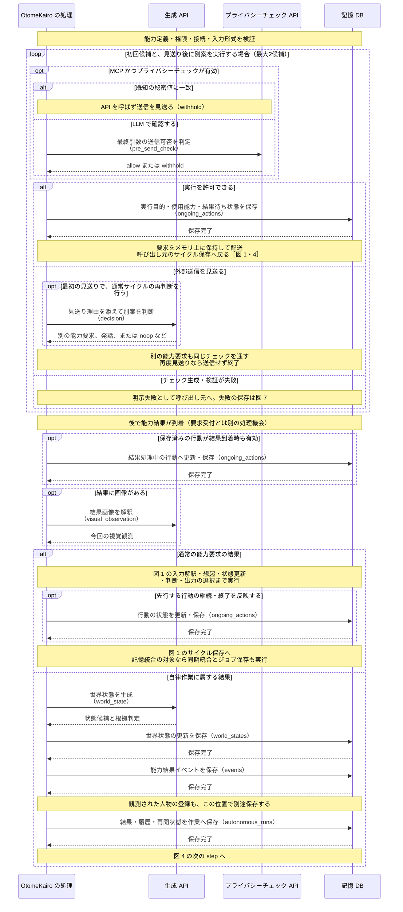
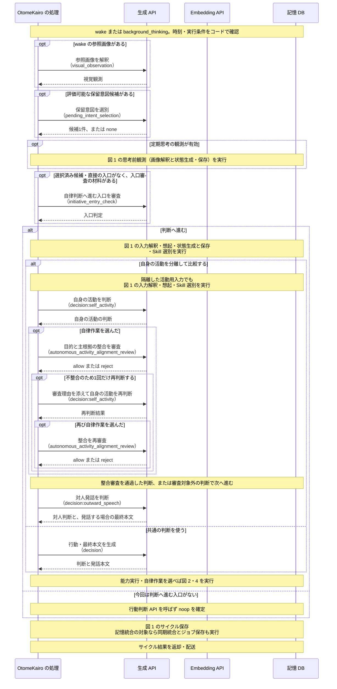
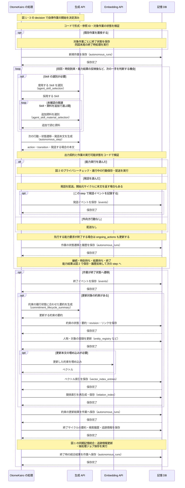
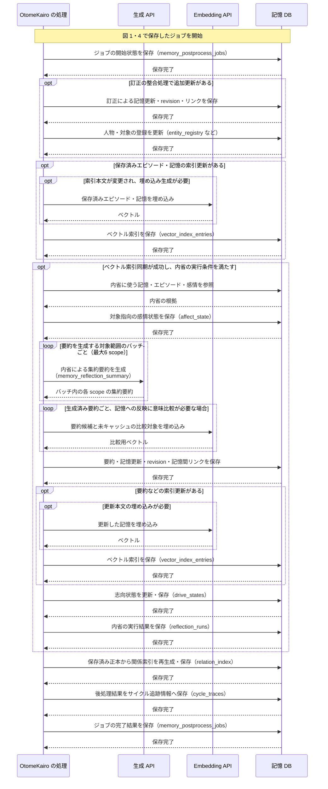
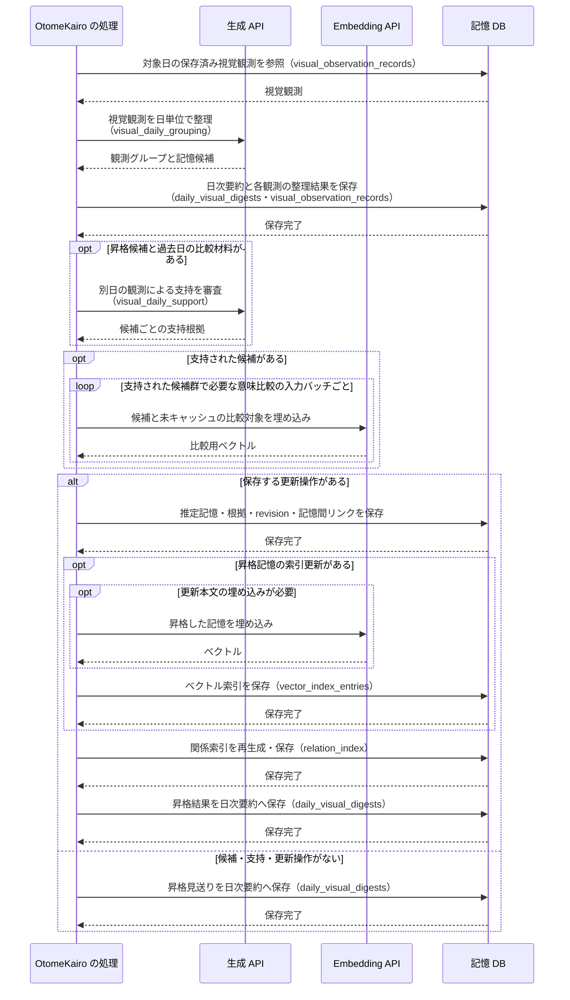
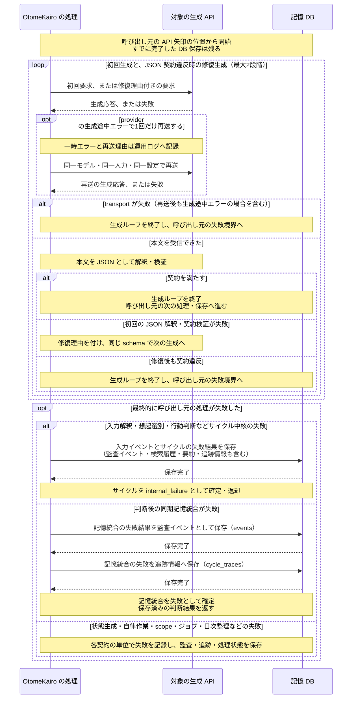

# LLM 呼び出しシーケンス

この文書は、**LLM・Embedding の API を呼ぶ順序と、その前後で DB に保存するタイミング**を実装から追うための見取り図である。
まず図 1 を読むと、通常会話の入力から、判断、記憶の保存、結果返却までを一続きに追える。
能力実行と自律作業の分岐は図 2〜4、結果返却と独立して進む記憶整理は図 5〜6、追加の再送・修復は図 7 に示す。
意味境界、入出力契約、失敗条件の詳細は各節の正本文書を参照する。
図は実モデルを使う経路を示す。

## 図の読み方

- 時間は上から下へ進む。参加者は、処理、生成 API、Embedding API、記憶 DB を基本とし、必要な図だけプライバシーチェック API を加える。
- API への実線の矢印 1 本は、通常成功時の API 呼び出し 1 回を表す。ラベルは日本語の用途と実装上の `operation` 名である。内部関数の呼び出しや、API 内での推論過程は表さない。
- API の戻り矢印は受信結果を表す。その結果をコード側で検証・正規化し、採用できる場合に後続処理へ進む。再送・修復が起きる位置は図 7 を参照する。
- DB への「保存」と、その戻りの「保存完了」が永続化の位置である。同一トランザクションの対象はまとめ、別の保存処理は矢印を分ける。複数の保存を一括で取り消すトランザクションは表していない。
- DB は共通の記憶 DB（`memory.db`）。生成 API は選択中の `selected_model_preset_id`、プライバシーチェック API は `pre_send_check_model_preset_id`、Embedding API は選択中の記憶集合の `embedding` 設定を使う。
- 参照だけの DB アクセスは必要な箇所へ集約する。状態取得に伴う有効期限の整理や補助登録は、その段階の注記にまとめる。参照欠損の修復は DB 更新として示す。
- `opt` は条件付き処理、`alt` は分岐、`loop` は対象ごと・試行ごとの繰り返しを表す。別図の参照区間や、配送、時刻到来、結果返却などの境目は `Note` に記す。

## 図 1: 通常会話 — 入力から記憶保存・結果返却まで

入口は `handle_conversation()`。発話を選ぶ通常成功経路を基本とし、別の行動を選んだ場合の接続位置も示す。
**世界状態・活動状態は行動判断前に保存し、会話イベントは判断後、エピソード・長期記憶は記憶の解釈とコード側の検証後に保存する。**
この同期処理と後処理ジョブの保存を終えてから、サイクル結果を返す。

```mermaid
sequenceDiagram
    participant C as OtomeKairo の処理
    participant L as 生成 API
    participant E as Embedding API
    participant D as 記憶 DB

    Note over C,D: 人物発話を受信
    C->>D: 直近会話・現在の作業を参照
    D-->>C: 判断前の文脈
    opt 進行中の自律作業を一時停止する
        loop 対象の作業ごと
            C->>D: 作業の一時停止を保存（autonomous_runs）
            D-->>C: 保存完了
        end
    end

    opt 非終端 run があり、明示的な cancel_all ではない
        C->>L: 会話による既存作業の取消対象を選別<br>（autonomous_run_intervention）
        L-->>C: 取消対象と判断理由
        loop 取消対象の作業ごと
            C->>D: 作業の取消を保存（autonomous_runs）
            D-->>C: 保存完了
            Note over C,D: 図 4 の終端処理で約束と記憶を更新
        end
        C->>D: 取消判断の監査を保存（events）
        D-->>C: 保存完了
    end

    Note over C,D: 1. 今回の観測と入力解釈
    loop 有効な思考前観測で画像を取得できた対象ごと
        C->>L: 画像を解釈<br>（visual_observation）
        L-->>C: 今回の視覚観測
        C->>L: 世界状態を生成<br>（world_state）
        L-->>C: 状態候補と根拠判定
        C->>D: 世界状態の更新・置換・失効を保存（world_states）
        D-->>C: 保存完了
        opt 活動状態の生成対象がある
            C->>L: 活動状態を生成<br>（activity_state）
            L-->>C: 活動候補と根拠判定
            C->>D: 活動状態の更新・失効を保存（activity_states）
            D-->>C: 保存完了
        end
    end
    opt 会話に添付画像がある
        C->>L: 添付画像を解釈<br>（visual_observation）
        L-->>C: 今回の視覚観測
    end
    Note over C,D: 視覚観測の本文は判断材料として保持<br>判断後に視覚記録として保存する
    C->>L: 入力を解釈<br>（input_interpretation）
    L-->>C: 想起方針（recall_hint）と必要な回答根拠（answer_contract）

    Note over C,D: 2. 想起と回答根拠の取得
    C->>D: 記憶・エピソード候補を参照
    D-->>C: 想起候補
    opt 関連検索のクエリがある
        C->>D: 過去の視覚記録と索引の状態を参照
        D-->>C: 埋め込みが不足・変更された記録
        loop 検索クエリと視覚索引の不足・変更分をまとめたバッチごと
            C->>E: 検索クエリ・過去の視覚記録を埋め込み
            E-->>C: 各入力のベクトル
            opt バッチに索引更新対象がある
                C->>D: 視覚記録のベクトル索引を保存<br>（visual_observation_vector_entries など）
                D-->>C: 保存完了
            end
        end
        C->>D: 記憶・エピソード・過去の視覚記録を意味検索
        D-->>C: 関連する想起候補
    end
    C->>D: 関係索引・同じ対象の記憶・記憶間リンクを参照
    D-->>C: 追加候補と支持・矛盾・由来
    opt 想起候補または競合がある
        C->>L: 想起候補と採用順を選別<br>（recall_pack_selection）
        L-->>C: 採用する記憶・エピソード
    end
    opt 根拠イベントの参照を確認・修復する
        C->>D: 根拠を取得し、欠損参照の修復と監査を保存
        D-->>C: 根拠と修復結果（更新があれば保存完了）
    end
    Note over C,D: 原文・日時・視覚記録など必要な根拠を集め、回答根拠を解決

    Note over C,D: 3. 状態の生成・保存と行動判断
    Note over C,D: 現在状態の取得時には、期限切れの失効も DB に反映する
    opt 空でない人物発話がある
        C->>L: 世界状態に使う本人報告を選別<br>（world_state_source_selection）
        L-->>C: 更新根拠となる報告
    end
    opt 観測要約・能力結果・状態更新の根拠のいずれかがある
        C->>L: 世界状態を生成<br>（world_state）
        L-->>C: 状態候補と根拠判定
        C->>D: 世界状態の更新・置換・失効を保存（world_states）
        D-->>C: 保存完了
    end
    opt 活動状態の生成対象がある
        C->>L: 活動状態を生成<br>（activity_state）
        L-->>C: 活動候補と根拠判定
        C->>D: 活動状態の更新・失効を保存（activity_states）
        D-->>C: 保存完了
    end
    opt Skill 一覧がある
        C->>L: 使用する Skill を選別<br>（agent_skill_selection）
        L-->>C: 採用する Skill
        loop 未確認の関連 Skill・資料を追加で選ぶ間
            C->>L: 追加資料を選別<br>（agent_skill_material_selection）
            L-->>C: 追加で読む資料
        end
    end
    opt 共有条件の確認に使う出所イベントの参照を修復する
        C->>D: 出所を取得し、欠損参照の修復と監査を保存
        D-->>C: 出所と修復結果（更新があれば保存完了）
    end
    C->>L: 行動・共有範囲・最終本文を生成<br>（decision）
    L-->>C: 判断と発話本文（speech_text）
    Note over C,D: 能力実行を選ぶ場合は図 2<br>自律作業を選ぶ場合は図 4 をこの位置で実行

    Note over C,D: 4. 判断サイクルの保存
    opt 保留意図を選んだ場合
        Note over C,D: 候補をメモリ上に保持。要約は次のサイクル記録へ含める
    end
    C->>D: 入出力イベント・検索履歴・サイクル要約・追跡情報<br>・今回の視覚記録を保存
    D-->>C: 保存完了（events・retrieval_runs・cycle_summaries<br>・cycle_traces・visual_observation_records）
    Note over C,D: 会話参加者の登録も、この区間で別途保存<br>（entity_registry・entity_aliases）

    Note over C,D: 5. 同期の記憶統合（consolidate_turn）
    C->>L: 保存する経験・記憶・感情・訂正を解釈<br>（memory_interpretation）
    L-->>C: エピソード・採用する記憶候補・感情・訂正選定
    Note over C,D: コードで出力形式・参照・数値範囲を検証し、保存用に正規化
    loop 構造条件を通った意味比較の入力バッチごと
        C->>E: 候補群と未キャッシュの比較対象を一括で埋め込み
        E-->>C: 比較用ベクトル
    end
    C->>D: エピソード・記憶更新と revision<br>・記憶間リンク・感情・mood を保存
    D-->>C: 保存完了（episodes・memory_units・revisions<br>・memory_links・episode_affects・mood_state）
    opt 人物・対象の登録を更新する
        C->>D: 記憶からの人物・対象の登録を保存（entity_registry など）
        D-->>C: 保存完了
    end
    C->>D: 同期統合結果を追跡情報へ保存（cycle_traces）
    D-->>C: 保存完了
    C->>D: 後処理ジョブを保存（memory_postprocess_jobs）
    D-->>C: 保存完了
    Note over C,D: ジョブを実行待ちに登録<br>この時点から図 5 が独立して進められる
    Note over C,D: サイクル結果を返却（発話する場合は生成済みの本文を返す）
```

`input_interpretation` は、想起方針と回答に必要な根拠の条件を 1 回で返す。同期の記憶統合も `memory_interpretation` の **1 回の生成 API** で、記憶の採否、エピソード、感情、訂正対象を決める。出力の形式・参照・数値範囲はコードで検証する。
保存前の意味比較に使う Embedding と、保存後に検索索引へ反映する Embedding［図 5］は別の呼び出しである。
意味比較の対象条件は [記憶更新の比較キー](../memory/記憶更新と再整理.md#比較キー)、検索入力の一括化は [意味検索用索引](../memory/想起と判断.md#意味検索用索引)、バッチ実行単位は [LLM補助契約共通](LLM補助契約共通.md#embedding-のバッチ実行) を参照する。
思考前観測の状態更新と、その後の人物発話に基づく状態更新も別の呼び出し箇所である。
後半の世界状態生成は、先行する `world_state_source_selection` が状態報告なしを返し、観測要約や他の状態更新の根拠もなければ省略する。この場合も、非空の人物発話に対する選別 API は呼ぶ。一般的な質問だけで、観測や現在状態の追加情報がない場合が該当する。
前半の思考前観測は能力結果の更新経路を通るため、画像解釈後に世界状態の生成 API を呼ぶ。API を呼んだ結果として状態候補が 0 件になる場合と、API 自体を呼ばない場合を区別する。

実装: [会話入口](../../../src/otomekairo/service/input/cycle.py)、[入力パイプライン](../../../src/otomekairo/service/input/pipeline.py)、[サイクル保存](../../../src/otomekairo/service/input/trace_persist.py)、[記憶統合](../../../src/otomekairo/memory/consolidator.py)、[記憶処理の確定](../../../src/otomekairo/service/memory.py)。
契約: [想起と判断](../memory/想起と判断.md)、[世界状態](../runtime/world_state.md)、[活動状態](../runtime/activity_state.md)、[視覚入力のパイプライン統合](../capability/vision_capture画像意味理解.md#パイプライン統合)、[記憶更新と再整理](../memory/記憶更新と再整理.md)。

## 図 2: 能力実行 — プライバシーチェックと結果到着後

入口は判断または自律 step が返した `capability_request`。
**プライバシーチェックを通った後、実行目的・使用能力・結果待ち状態を `ongoing_actions` に保存してから要求を配送する。**
要求そのものの受付待ちはメモリ上に保持する。サイクルの要求要約・監査情報は、呼び出し元の記録保存時に残る。

自律 step の送信見送りでは、`decision` の代わりに `autonomous_step` を再生成する。
図 2 の通常判断・自律 step からの要求では、現在の能力定義はいずれも `ongoing_actions` を保存する。結果を待っている目的と使用能力を、結果処理や後続判断で参照するためである。
思考前観測はその場で取得結果を待ち、得られた観測を図 1 の入力解釈と判断へ直接引き継ぐ。

実装: [能力実行](../../../src/otomekairo/service/capability.py)、[通常の結果サイクル](../../../src/otomekairo/service/spontaneous/capability_cycle.py)、[自律作業の結果処理](../../../src/otomekairo/service/autonomous_run.py)。
契約: [プライバシーチェック](pre_send_check.md)、[状態モデル](../runtime/状態モデル.md)、[自律作業](../runtime/autonomous_run.md)。

## 図 3: 自律判断 — 入口判定と分離判断

入口は `wake` または定期思考の `background_thinking`。
**判断へ進む前の選別 API と、行動判断を分離する場合の追加 API** を示す。
通常サイクルと共通の想起・状態生成・保存は、図 1 の該当区間を参照する。

再判断後も整合審査に通らなければ、対人判断へ進まず明示失敗とする。
非会話サイクルの記憶統合の実行条件は [記憶更新と再整理](../memory/記憶更新と再整理.md) を正とする。

実装: [起床サイクル](../../../src/otomekairo/service/spontaneous/wake.py)、[入口判定](../../../src/otomekairo/service/input/wake_pipeline.py)、[分離判断](../../../src/otomekairo/service/input/decision_comparison.py)。
契約: [自律判断のループ](../runtime/自律initiative_loop.md)、[保留意図候補の LLM 選別](保留意図候補のLLM選別.md)。

## 図 4: 自律作業 — 開始・各 step・終了

図 1・3 の `decision` が自律作業の開始（`kind=autonomous_run`）を決定すると、図 4 へ進む。
**コードで形式・参照 ID・対象作業の状態を検証して作業を保存し、初回 step を生成する。**
各 step が次の行動と完了・継続を決定し、行動と状態遷移を反映する。
終了時は、約束の更新と、終了サイクルの記憶統合を続けて行う。

能力実行の結果待ちは step の後で行う。結果到着前に、要求を出した step の状態遷移が保存される。
送信見送り時の追加 step は図 2、生成自体の再送・修復は図 7 を参照する。

実装: [自律作業](../../../src/otomekairo/service/autonomous_run.py)、[約束の終了時更新](../../../src/otomekairo/memory/consolidator.py)。
契約: [自律作業](../runtime/autonomous_run.md)。

## 図 5: 記憶の後処理 — 索引同期と内省

入口は保存済みの `memory_postprocess_job`。
**同期の記憶保存後に開始できる処理であり、サイクル結果の返却とは完了順が固定されない。**
ジョブの開始、各データの更新、ジョブの終了は、それぞれ別に保存する。

意味比較用の埋め込みは記憶更新を組み立てるために使い、索引用の埋め込みは保存した本文を検索へ反映するために使う。
内省の対象がなければ要約 API は呼ばない。関係索引は先行する補助処理の成否にかかわらず保存済み正本から再生成する。
scope ごとの生成失敗と、ジョブ全体の失敗の扱いは各契約を正とする。

実装: [記憶後処理](../../../src/otomekairo/service/memory.py)、[ジョブ実行](../../../src/otomekairo/memory/consolidator.py)、[ベクトル索引](../../../src/otomekairo/memory/vector.py)、[内省統合](../../../src/otomekairo/memory/reflection/consolidator.py)。
契約: [記憶更新と再整理](../memory/記憶更新と再整理.md)、[内省要約の LLM 生成](../memory/内省要約のLLM生成.md)、[感情モデル](../runtime/感情モデル.md)。

## 図 6: 視覚記憶 — 日次整理と長期記憶への昇格

入口は対象日の保存済み視覚記録。会話中の画像解釈とは別の処理機会に実行する。
**日次要約を保存してから支持根拠を審査し、採用できる記憶の保存後に検索索引を更新する。**

日次整理が失敗した場合は失敗した日次要約を保存する。支持審査以降の失敗は昇格結果として保存し、先に保存した日次要約と区別する。

実装: [日次視覚整理](../../../src/otomekairo/service/visual_daily.py)、[記憶更新操作](../../../src/otomekairo/memory/actions.py)。
契約: [記憶更新と再整理の視覚記憶昇格](../memory/記憶更新と再整理.md#daily_visual_digest-からの長期記憶昇格)。

## 図 7: 共通 — 追加の再送・出力修復と処理の失敗確定

図 1〜6 の生成 API・プライバシーチェック API の矢印は、通常成功時の 1 回を示す。
**同じ位置で API 呼び出しが追加される場合**を下図に示す。
生成途中の provider エラーによる同一要求の再送と、受信した JSON の契約違反による修復は別の処理である。
一時的な API エラーや修復の試行は運用ログへ記録する。呼び出し元のサイクル・記憶統合などの失敗が確定した時点で、その処理結果を DB に保存する。

HTTP 要求や schema の拒否、出力上限、content filter などは、JSON 修復へ進める生成応答とは区別する。
同一要求の再送でも生成途中エラーが続けば、その時点で明示失敗となる。
現在の実装では、サイクルや記憶統合の失敗結果に `failure_reason` として例外の文言も保存する。運用ログと DB に残る処理結果の役割は [デバッグ可能性](../runtime/デバッグ可能性.md) を参照する。
失敗範囲と追加呼び出しの条件は [LLM 構造化出力 transport](LLM構造化出力transport.md)、[LLM 補助契約共通](LLM補助契約共通.md)、各 role の契約を正とする。

実装: [生成・検証・修復](../../../src/otomekairo/llm/client.py)、[API transport](../../../src/otomekairo/llm/transport.py)、[入力失敗の確定](../../../src/otomekairo/service/input/cycle.py)、[記憶統合失敗の確定](../../../src/otomekairo/service/memory.py)。
