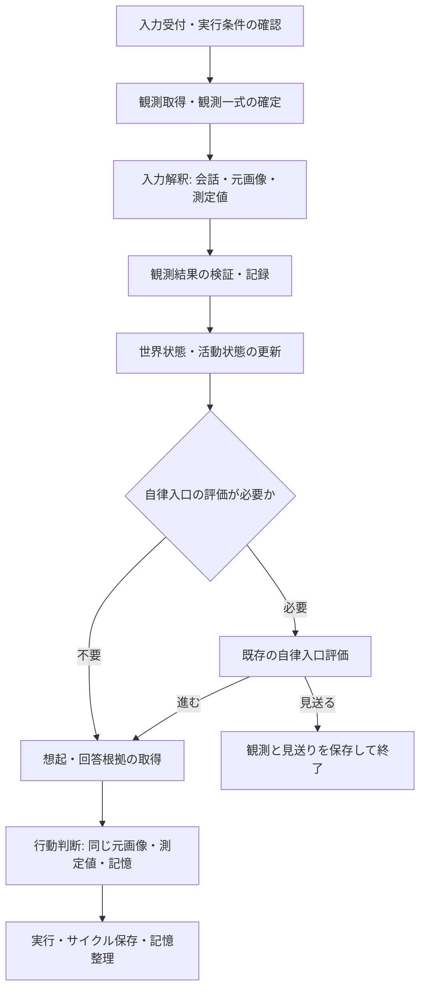

# 周辺環境

観測の同一性、鮮度、snapshot、処理順と保存の正本である。
HTTP wire は [観測入力 API](../api/観測入力.md)、LLM契約は [入力解釈](../llm/入力解釈.md) を参照する。

## 採用する構成

会話、現在の画像、センサーの測定値を `input_interpretation` に渡す。
一回の生成で観測説明、変化判定、想起方針、回答に必要な根拠の条件を得る。
独立した `visual_observation` の生成はこの処理へ統合する。
想起後の `decision_generation` には、同じ元画像と測定値を渡す。

この一回は「同じ向き・同じ観測一式に対する入口解釈」の単位である。
隔離された自身の活動の入力解釈、transport の再送、契約 repair は、それぞれ従来の別単位として扱う。
`world_state`、`activity_state`、`world_state_source_selection`、行動判断、記憶整理の独立した責務は維持する。
呼び出し回数全体や応答時間の短縮は、比較検証で確認する。

## 周辺環境の範囲

LLM 入力の共通キーを `surroundings`、人間向け表示名を「周辺環境」とする。
既存の world-state 更新用 `environment_context` とは用途が違うため、同名の型を増やさない。
`surroundings` は現在の観測と短期状態から構築する入力 view であり、独立した環境状態の保存先にはしない。

| 材料 | 配置と扱い |
| --- | --- |
| 採用済み camera | `surroundings`。自身の視覚の根拠 |
| desktop / virtual source | `surroundings`。ユーザー側の環境として出所を保持 |
| 温湿度など | `surroundings`。測定値と単位を保持 |
| 人感など | `surroundings`。検知状態、または最終反応についての報告 |
| 会話添付画像 | `input_materials`。現在の会話の資料 |
| wake reference の画像・テキスト | `input_materials`。当回の参照資料 |
| 過去の観測・記憶 | `recall_pack`、または観測時刻を持つ短期状態 |

画像があることだけを理由に、会話資料を現在の部屋の状態へ採用しない。
既存の会話添付画像と world-state の境界を維持する。
外部参照から現在状態の候補を作れる条件は、現行の wake reference の境界に従う。

## 観測元と場所

場所は `place_ref` と表示名を持つ設定定義とする。
camera source と sensor source は、それぞれの設定定義から場所を参照する。
同じ機器を別の場所へ移したときは、その設定変更で参照を更新する。
場所が未設定なら `place_ref=null` を保持し、表示では「場所未設定」とする。
部屋名、画像本文、ユーザーの表示名から機械的に場所を推定しない。

source の人間向け名、所有境界、場所は登録設定を正とする。
`source_owner=self / user_environment` は、自身の感覚として採用した source か、ユーザー側の環境かを表す。
`self` は測定値を自身の身体感覚へ読み替える指定ではない。温度は温度計の測定として扱う。
観測された人物は、当回の構造化された人物同定根拠を使う。
source の所有境界や人格上の関係は、画像内の人物の同定根拠にしない。

## 内部データ

### 観測一式

`ObservationSnapshot` は当回に利用する観測を固定した不変の値とする。

| 項目 | 内容 |
| --- | --- |
| `snapshot_id` | server が発行する当回の識別子 |
| `snapshot_at` | 観測取得を終え、センサーの最新値を取り込んだ基準時刻 |
| `memory_set_id` | この判断が経験を保存する記憶集合 |
| `environment_observations` | 周辺環境に属する有効な観測 |
| `input_material_observations` | 会話添付・wake reference の観測 |
| `source_reports` | 未取得・失敗・期限切れなどの取得状況 |
| `media_bundle` | 画像を保持する当回専用の非永続オブジェクト |

取得する source の設定と有効状態も、観測開始時に固定する。
独立した source の取得は並行実行できる。同じ機器に対する capture と PTZ などは既存の実行境界で直列化する。
取得中に届いたセンサー更新は `snapshot_at` の確定時に取り込む。
確定後の更新は次の判断で使い、当回の想起や行動判断の値を差し替えない。
追加の能力実行結果は、新しい判断機会で新しい snapshot にする。

### 観測

観測の共通 envelope は次を持つ。値や種別は取得経路と登録設定からコードが確定する。

| 項目 | 内容 |
| --- | --- |
| `observation_id` | 同じ採用サンプルを複数 cycle から参照できる ID |
| `source_ref / channel_id` | 観測元と、その機器内の項目。画像の channel は `null` |
| `origin_kind` | `vision_capture / sensor_report / conversation_attachment / wake_reference` |
| `source_kind / source_label / source_owner` | source の種類、名前、所有境界 |
| `place_ref` | 登録済み場所。資料画像・未設定場所は `null` |
| `observed_at / received_at / expires_at` | 観測時刻、受信時刻、有効期限 |
| `time_basis` | `captured / measured / reported / received / resolved`。時刻が表す取得経路 |
| `kind` | `image / measurement / event` |
| `payload` | 種別ごとの値 |

成功した観測だけにこの envelope を作る。失敗した取得は `source_reports` に記録する。
観測側の `source_ref` は機器・資料の参照であり、world-state の根拠 event / cycle を示す `source_ref` とは別の型として扱う。
`source_ref` と `channel_id` の組が測定項目の同一性である。
画像 source は `vision_source_id`、添付・参照資料はその入力由来の参照を使う。
画像を複数持つ場合も、画像ごとに独立した `observation_id` と `media_ref` を持つ。

| `kind` | `payload` |
| --- | --- |
| `image` | `media_ref`、media type。実データは `media_bundle` が保持 |
| `measurement` | `value`、`unit`。値は登録した number または boolean |
| `event` | `monitoring_started_at`、`last_occurred_at`。最後の検知についての機器報告 |

測定値と単位は connector が機器仕様に従って正規化し、server は登録契約と照合する。
LLM に測定値の再生成や単位変換をさせない。
number の非有限値、boolean と number の取り違え、登録単位の不一致は受信契約違反とする。

### センサーの現在観測

初期対象は「各 channel の最新の観測」であり、生 telemetry の全履歴ではない。
connector が定期取得または機器通知から更新し、server は最新の報告を保持する。
温度、湿度、検知状態は measurement とする。検知状態を boolean として返す機器も扱える。
最終反応を報告する event channel は、監視開始時刻と最後の反応時刻を持つ。
`last_occurred_at=null` は監視開始以降に記録された反応がないという意味であり、人物不在の確定ではない。
新しい反応がなくても connector は監視状態を報告でき、報告自体の鮮度と反応の古さを区別する。

最新値・取得状態は process-local な観測 runtime に置く。
起動直後は未取得とし、記憶にある過去値から現在値を作らない。
sample の同一性は source、channel、producer の `sample_id` の組とする。
同じ sample から安定した観測 ID をコードが生成し、再送で新しい観測へ変わらないようにする。
同じ値を新しく測定した報告は、新しい sample と観測時刻を持つ。

### 件数境界

| 対象 | 上限 |
| --- | --- |
| 一回の snapshot の画像 | 8 件 |
| 一回の snapshot のセンサー観測 | 32 件。各 channel の最新報告 1 件 |
| 有効な sensor channel の設定総数 | 32 件 |

画像入力一件ごとの現行上限と source 件数上限は維持し、合計でこの snapshot 上限を検証する。
件数超過は `observation_limit_exceeded` として当回を明示的に失敗させる。
意味単位の途中切断、画像の暗黙の間引き、センサー項目の途中打切りは行わない。
モデル側の容量不足も provider の明示失敗として扱う。

## 時刻、鮮度、取得状態

`observed_at` は撮影・測定した時刻、`received_at` は server が受け取った時刻である。
cycle の開始時刻を観測時刻の代わりに使わない。
機器が時刻を返さない場合は、connector が実際に取得した時刻を付ける。
時刻変換は [現行の時刻モデル](../runtime/時刻モデル.md) に従う。
資料画像の時刻は受理・解決の時刻であり、撮影時刻とは区別する。詳細な取り込み field は API 契約を正とする。

センサー報告の有効期限は、観測時刻に source の `max_age_seconds` を加えてコードが決める。
画像の当回利用期限は、撮影時刻に画像用の有効期間を加えて決める。
event の監視報告には報告自体の有効期限を設け、過去の反応時刻はそのまま保持する。
鮮度判定は `snapshot_at` を基準にする。
`vision_capture` の画像は、[観測入力 API](../api/観測入力.md#visioncapture-result) で許容した送信元の時計差をsnapshotの鮮度判定でも許容する。撮影時刻は書き換えず保持し、snapshotより先の時刻はLLM向けの経過表示で撮影元の時計差として示す。画像の有効期限は撮影時刻と画像用の有効期間で決める規則を維持する。
長時間の処理後も snapshot の観測時刻を保持し、その後の外界が確認済みであるとは扱わない。
再確認の必要性は行動判断が時刻と目的から評価し、必要な追加取得を選ぶ。

`source_reports` の状態は `not_observed / failed / stale` とする。
正常な値の 0、boolean の false、反応記録のない null はそれぞれ有効な値であり、取得失敗と区別する。
新しい取得失敗が届いた channel は失敗状態にする。以前の成功値はその channel の現在値として出さない。
新たな成功報告で回復する。
有効期限切れの観測は現在の観測一覧に入れず、取得状況として期限切れを示す。
正常なスキップは従来どおり監査側だけへ残し、外界の観測事実として渡さない。
明示的な能力要求のスキップ結果は、その要求に対する結果として保持する。
定期思考時の未接続 camera の対象除外は既存方針を維持する。
センサーの `not_observed` は、有効な source がまだ成功・失敗いずれの報告もしていない状態を示す。

## 入力解釈と判断への転送

入力の配置、画像part、生成契約と検証は [入力解釈](../llm/入力解釈.md) を正とする。

## 各入口の実行順

### 通常会話

1. 入力・人物参照を検証し、既存の自律作業割り込みを処理する。
2. 有効な思考前観測を取得し、添付資料と最新センサー報告を含む snapshot を確定する。
3. 統合入力解釈を一回実行し、検証済み結果を当回の値として保持する。
4. 観測記録を確定し、世界状態・活動状態の更新を行う。
5. 入力解釈の方針と観測説明から検索クエリを作り、想起と回答根拠の取得を行う。
6. 原観測と記憶を渡して行動判断を行い、既存の実行・保存・記憶整理へ進む。

`augmented_query_text` は入力解釈後に組み立てる。人物の `current_input.text` は原文を維持する。
同じ回の新しい観測は snapshot から直接渡し、想起検索で同じ資料を取得する経路は除外する。
本人報告を抽出する `world_state_source_selection` は、既存の条件で状態更新前に行う。

### 定期思考・API起床

1. due、直列化、取消、API依頼など既存の実行条件を確認する。
2. 当回の対象を観測し、参照資料とセンサー値を集める。
3. 統合入力解釈、観測記録、世界状態・活動状態更新を行う。
4. 更新結果を使い、既存の direct entry または `initiative_entry_check` を評価する。
5. 見送る場合も観測と入口評価の trace を確定する。進む場合は生成済みの想起方針を使って想起する。
6. 既存の比較単位に応じて行動を判断する。

`first_seen / changed`、due な定期思考トピック、API依頼など既存の入口条件の意味は維持する。
観測変化のシグナルは視覚専用から共通観測へ一般化し、センサーにも同じ入口比較を適用する。
新しい sample や値の差があることだけで、意味上の `changed` や発話を強制しない。
入力解釈を入口評価後に再実行しない。
前回までの変化情報を使って当回の統合入力解釈を省く循環は作らない。
API依頼と人物入力は、自発発話の入口評価によって打ち切らない。
観測中の会話追加を検出する既存の外向き発話抑制も維持する。

### 能力結果・自律作業

`vision.capture` の結果は、新しい snapshot の画像として統合入力解釈へ渡す。
結果ごとに全 camera を自動再取得しない。センサーの最新値は新しい snapshot の基準時刻で取り込む。
要求時の `source_visual_observations` は過去の要求根拠として保持し、新しい画像や現在値として扱わない。
result follow-up の視覚 source 絞り込みを snapshot の view にも適用する。

`autonomous_step_generation` に観測結果を渡す場合も、共通の入力解釈結果と snapshot を使う。
新しい観測一式を使う step は、その step の向きと作業目的で統合入力解釈を行う。
既存 step の記憶取得範囲を維持し、生成した想起方針だけを理由に新しい全履歴検索を増やさない。
同じ同期判断で既に解釈した snapshot を使う場合も、向き・比較 scope・観測 view の一致を確認して再利用する。
観測のない timer step は新たな画像を捏造せず、許可された最新センサー報告と既存の記録を使う。
run 開始と同じ同期処理中は、その範囲で生存する媒体を使える。
非同期の timer、再起動、別 cycle へ raw image を持ち越すことはしない。

### 比較単位ごとの材料

| 用途 | 周辺環境・媒体の view |
| --- | --- |
| 通常会話・API依頼・通常 result follow-up | 当該入力に許可された source と資料 |
| `comparison_scope=outward_speech` | その比較に許可された現在観測と資料 |
| 隔離した `comparison_scope=self_activity` の入口解釈・想起・判断 | 周辺観測・資料は空。既存の自身の活動の材料範囲を維持 |
| 自律 step | 起点・作業・結果に対する現行の所有境界と視覚除外条件を適用 |
| `world_state / activity_state / initiative_entry_check` | 生成済み観測説明、必要な測定値、根拠参照。画像は再送しない |
| `pre_send_check` | 現行の専用入力だけを使う |

この変更では、自身の活動の独立性や、既存 run の視覚除外条件を緩めない。
入力 view の絞り込みは、source ID、所有境界、origin、比較 scope という機械的な条件で行う。
隔離 view では、その周辺観測から作った短期状態・比較資料・取得状況も一緒に除外する。

## 世界状態への投影

観測由来の world-state 候補は、観測元ごとの候補集合として作る。
`state_sources[]` の各候補に `observation_source_ref / channel_id / place_ref / source_observation_refs` を持たせる。
`observation_source_ref` は機器参照、`source_observation_refs` はその生成requestに提示された観測の正本IDである。参照方式は [LLM補助契約共通](../llm/LLM補助契約共通.md)、採番と外部sampleとの対応は [記憶データモデル](../memory/データモデル.md#内部識別子) を参照する。
観測に由来しない既存の本人報告・外部サービス候補はこの追加 metadata を `null` または空配列にする。
コードが候補の `candidate_ref / state_type / scope_type / scope_key` と原観測の対応を確定し、LLM は候補を参照して状態を要約する。
一つの型に複数 source があっても、同じ `state_source:<state_type>` へまとめない。

原測定値と説明は、候補から参照できる観測一覧に一回だけ載せる。
視覚 source は現在の `vision_source_id` 単位、センサーの環境状態は `(observation_source_ref, channel_id)` 単位に置換する。
機器名や部屋名の自然文一致を統合キーに使わない。
環境以外の world-state とその現在の採用・件数上限は維持する。
`surroundings.observations` は world-state の前景選別と独立に原観測を保持し、world-state の件数上限で測定値を失わない。

## 短期状態・記憶・媒体の保存

| 対象 | 正本と保存時点 |
| --- | --- |
| 画像の詳細説明 | 既存 `visual_observation_record`。統合入力解釈の検証後に確定 |
| 採用したセンサー sample | 既存 `events` の新しい `kind=sensor_observation`。値・単位・観測時刻・source metadata を保存 |
| 観測を使った cycle | cycle trace に snapshot ID と観測参照を保存 |
| 世界状態 | 既存 `world_states`。観測説明から整理した短期条件 |
| 経験・長期記憶 | 既存の episode・memory 整理で重要性や反復性を判断 |
| raw image | 当回の `media_bundle` のみ |

観測が成功した事実と、その後の行動判断が成功した事実を分ける。
入口で見送った場合や、想起・行動判断が後で失敗した場合も、検証済み観測は記録として残す。
統合入力解釈が失敗した場合は、検証済みの説明が成立していないため視覚記録を作らない。
この場合も取得状況と数値 sample の機械的な監査情報は trace に残す。
snapshot の新規視覚記録と sensor event は同じ memory DB の一取引で確定する。
すでに保存済みの sensor event は、その取引内で同一性を検証して参照する。
観測記録後に process が終了して cycle の終端記録がない場合は、行動の完了を推定せず処理未完了として扱う。

センサー event の同一性は記憶集合と原観測 ID の組とし、同じ sample を利用するたびに経験イベントを増やさない。
最初に採用した cycle で記録し、後続 cycle は同じ観測の event を参照する。
別の記憶集合では、その集合が実際に使った観測として独立して記録する。
clone / delete は既存の event・視覚記録の記憶集合境界に従う。
生の全 telemetry、全検知イベント、温湿度の時系列分析はこの初期設計の対象外とする。

現在値の置換単位は `(source_ref, channel_id)`、視覚は `vision_source_id` とする。
環境の派生 world-state も source / channel を単位にし、場所を metadata に保持する。
同じ部屋に複数の測定器がある場合も値を併存させ、平均や優先順位を暗黙に決めない。
その world-state の期限は根拠観測の期限を超えないようにする。
過去の有効な world-state があっても、新しい取得失敗・失効を現在値として埋める経路に使わない。
source の取得状態を投影する段階で、対応する過去 state の現在値としての提示も止める。

画像の解放は、当回の判断・既存回数内の repair・同期実行が終わった `finally` で行う。
media bundle を event、trace、run、request record、background job にシリアライズしない。
後続会話では保存した説明文を根拠にし、元画像を再読したことにはしない。

## 失敗と監査

| 失敗単位 | 扱い |
| --- | --- |
| source の未取得・取得失敗・期限切れ | 取得状況を明示。その channel の現在値を作らない。他の観測と会話入力は成立した範囲で利用 |
| media 参照の欠落・snapshot 不整合・件数超過 | 統合入力解釈前に cycle を明示失敗 |
| 統合入力解釈の provider・parse・契約失敗 | 既存の repair 範囲後、cycle を `internal_failure` |
| world-state / activity-state 更新失敗 | それぞれ既存の失敗単位を維持。原観測は失わない |
| 観測記録の永続化失敗 | 観測記録段階で cycle を明示失敗し、行動判断へ進めない |
| 行動判断失敗 | 取得・解釈済みの観測と、判断失敗を分けて残す |

成功した部分だけの値で、失敗した統合出力の代わりを作らない。
画像非対応モデルでも説明文だけの別経路へ切り替えず、設定・provider の失敗として扱う。

cycle trace の `input_trace.observation_snapshot` は `snapshot_id / snapshot_at / memory_set_id / environment_observations / input_material_observations / source_reports / observation_interpretations` を持つ。原観測IDは各観測の `observation_id` に記録し、`observation_interpretations` の入力viewと対応付ける。
`input_trace.input_interpretation` に統合出力を残す。入力解釈が失敗したときも原観測の監査情報を保ち、この解釈結果は `null` とする。参照テキストの本文は snapshot の trace 用 view に含めず、資料参照・表示名・解決時刻だけを残す。
使用量と所要時間は既存のrole別生成ログに記録する。比較scopeと隔離した材料は既存のdecision traceと各scopeの文脈で追跡する。
原画像、base64、認証値、接続先の秘密、prompt 全文は保存しない。
`input_interpretation` の同じ生成を、旧 `visual_observation` と二重に呼び出し実績へ計上しない。
意味的な正しさは、原観測を渡した LLM 評価と人による確認で検証する。
